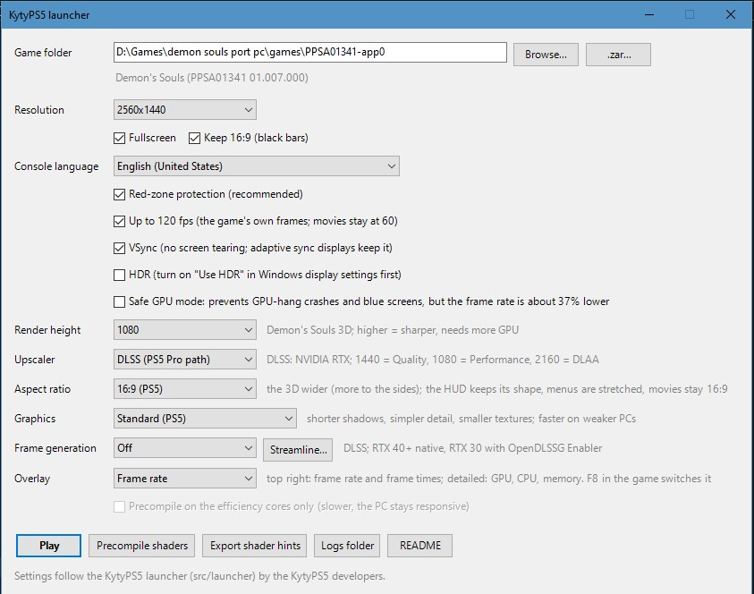
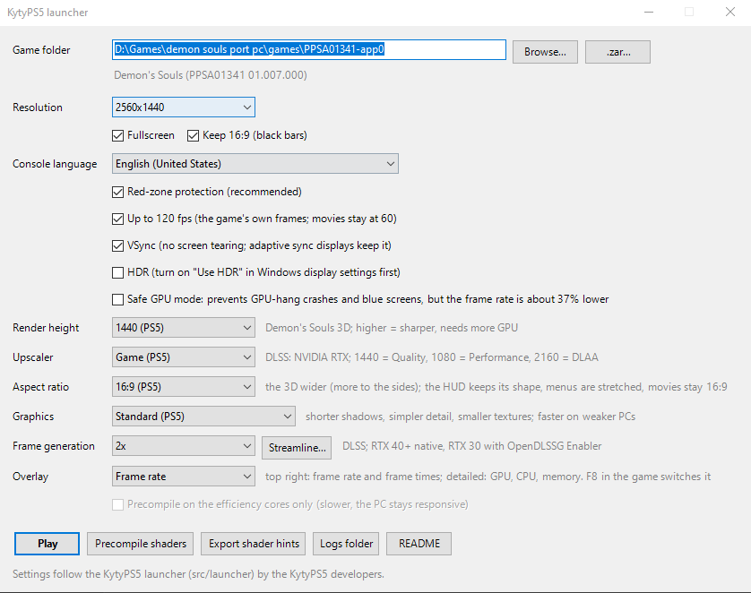
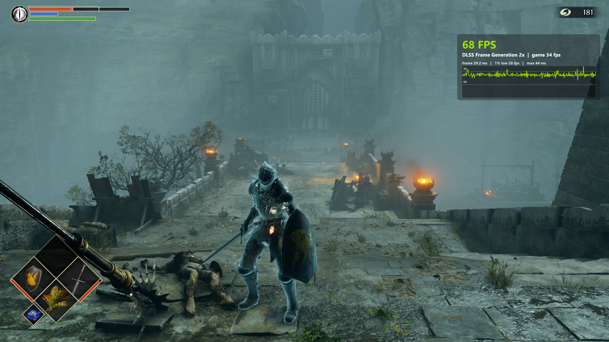
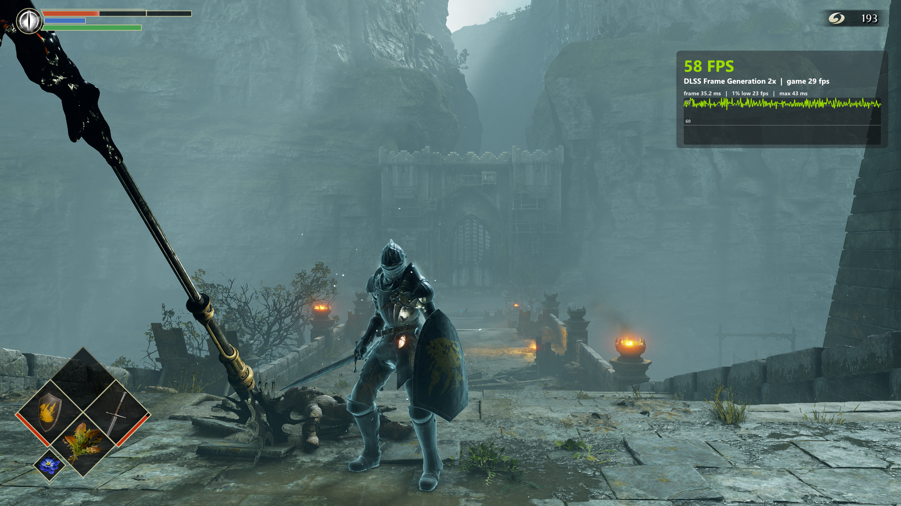
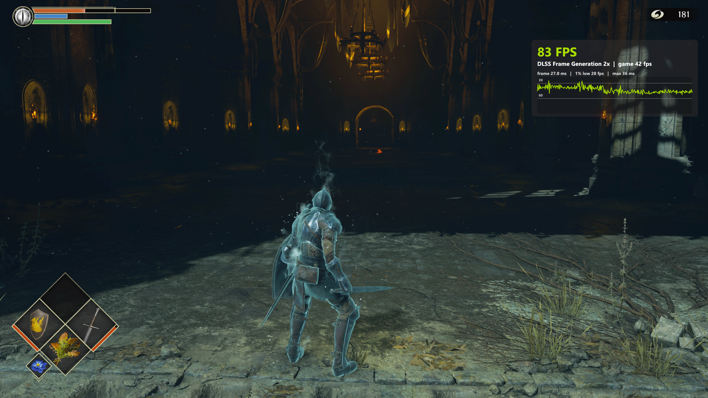
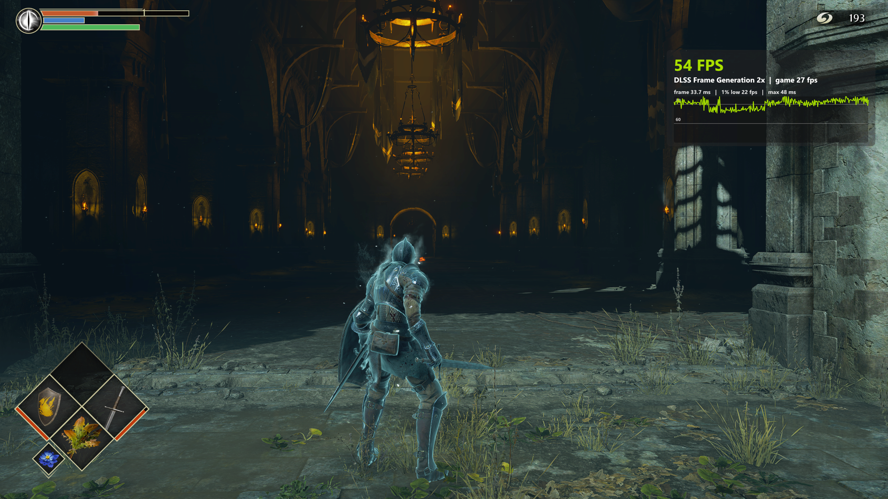

# RTX 30 frame generation: native 1440p and 1080p DLSS

**19 October 2026 update:** `v2026.10.19-upstream-merge` combines [chenxiao07's v20261019](https://github.com/chenxiao07/KytyPS5/releases/tag/v20261019) save/crash fixes with the integrations described below. The exact `aa4d4177` binaries were gameplay-verified by the user, with 85–95+ displayed FPS reported in Boletaria; existing screenshots retain their earlier measurements. For future upstream releases, use the [update playbook](UPSTREAM_UPDATE_PLAYBOOK.md).

This experimental fork uses NVIDIA Streamline with the OpenDLSSG compatibility path on RTX 30 cards. It is distinct from NVIDIA's officially supported native RTX 40+ frame-generation path. The configuration below was tested on an **RTX 3070 8 GB, Ryzen 7 5800X3D, 32 GB RAM, Windows, 1440p 240 Hz display**, Demon's Souls PPSA01341 v01.007.000. Other RTX 30 models and runtime versions need their own validation.

## Requirements and setup

1. Enable **hardware-accelerated GPU scheduling (HAGS)** under Windows Settings → System → Display → Graphics → Change default graphics settings, then **restart Windows**. NVIDIA lists HAGS as a DLSS-G requirement in its [Streamline integration guide](https://github.com/NVIDIA-RTX/Streamline/blob/main/docs/ProgrammingGuideDLSS_G.md).
2. Use a compatible NVIDIA driver, NVIDIA-signed Streamline runtime, and [OpenDLSSG Enabler](https://github.com/rodjunger/opendlssgenabler). Follow the proxy's instructions for the version you install; this PR does not replace the runtime DLLs or change proxy configuration.
3. Keep `version.dll` and the installed proxy files beside the actual emulator executable. For the local installation this is `D:\Games\demon souls port pc\`, including candidate EXEs; setting that working directory while running an EXE elsewhere is insufficient. Select the Streamline folder in the launcher. Availability detection alone does not prove successful SR or FG execution: check the logs and in-game overlay.
4. Run `launcher.cmd` from the package containing the rebuilt emulator. Native and DLSS use the **same executable**. Developers can select it explicitly with `powershell -NoProfile -ExecutionPolicy Bypass -File .\launcher.ps1 -EmulatorExe "C:\path\kyty_emulator.exe"`. Add `-DryRun` to inspect the command without launching.

## Two tested configurations

| Launcher option | DLSS scene reconstruction | Native scene rendering |
| --- | --- | --- |
| Resolution | 2560×1440 | 2560×1440 |
| Render height | 1080 | 1440 (PS5) |
| Upscaler | DLSS (PS5 Pro path) | Game (PS5) |
| Frame generation | 2× | 2× |
| Graphics / aspect | Standard (PS5) / 16:9 | Standard (PS5) / 16:9 |

Keep quality, texture settings, pacing and runtime configuration identical when comparing. Each upscaler remembers its own render height; check the displayed height after switching. Restart for output-size changes: resizing the window changes presentation, not the startup SR dimensions. Outputs below the Pro path's 1080-line minimum retain the game's TAA path with a diagnostic.

| DLSS settings | Native settings |
| :---: | :---: |
|  |  |

The DLSS route uses **1920×1080 scene inputs → 2560×1440 SR output**, while retaining the original **3840×2160 display/interface canvas** and layout constants. The game's existing composition consumes the full interface; presentation scales the completed image. Depth/motion remain at render resolution; FG color matches the backbuffer. The 4K UI attachment measured 63.75 MiB in a local capture; that is one allocation, not the total incremental pipeline cost.

## Observed screenshots, not benchmark averages

| Scene | 1080p DLSS + 2× FG (base / displayed) | Native 1440p + 2× FG (base / displayed) |
| --- | --- | --- |
| Bridge | 43 / 85 FPS | 30 / 60 FPS |
| Interior | 42 / 83 FPS | 27 / 54 FPS |

| DLSS bridge | Native bridge |
| :---: | :---: |
|  |  |

| DLSS interior | Native interior |
| :---: | :---: |
|  |  |

These are user-supplied instantaneous readings. Views differ, especially indoors, and earlier launcher runs could use different executables. Do not infer percentage gains or minimum performance from them. The displayed/base values are independently rounded. The older native 30/60 screenshot remains a historical example, not a fixed frame-rate promise.

FG performs additional GPU work and uses memory; **base FPS can fall when FG is enabled even while displayed FPS rises**. NVIDIA documents variable execution and memory costs in its [integration guide](https://github.com/NVIDIA-RTX/Streamline/blob/main/docs/ProgrammingGuideDLSS_G.md); its native-GPU cost figures are not measurements of this RTX 30 compatibility path. Generated frames do not increase simulation or input-update frequency. Overlay frame times do not measure end-to-end system latency.

Similar FG-off FPS at 1080p DLSS and native 1440p is inconclusive: CPU/emulator work, fixed GPU passes, DLSS execution overhead, pacing and scene differences can limit the benefit. Alt-tab also changes focus/presentation behavior, so use an explicit FG-off run to compare. A CPU bottleneck requires CPU/GPU timing evidence, not only total CPU utilization or two FPS snapshots.

For a controlled comparison, use the same executable, camera, warmed scene and settings. Repeat native1440+FG, DLSS1080 without FG, and DLSS1080+FG; record base/displayed FPS, frame times, usage/budget and SR/FG status. Include movement and repeated inventory transitions, not only stationary views.

## Logs and memory limitations

- Confirm SR logs report `1920x1080 -> 2560x1440`, rising successful evaluation counts, and no recurring errors/stretch fallbacks. A feature being available is insufficient.
- Confirm gameplay FG reports `presented=2` and the overlay identifies 2× FG. It can be inactive in menus, loading, or when valid inputs are unavailable.
- Enable `KYTY_SR_LOG=1` for evaluation counters and `KYTY_RESOURCE_LOG=1` for bounded resource-lifetime diagnostics.
- Memory policy samples DXGI adapter-matched usage/budget first, with Vulkan reporting as fallback; it trims completed image-pool entries before eligible LRU resources. Pressure enters below 512 MiB headroom, escalates after two seconds, and clears only above 768 MiB for two seconds. GPU completion, aliasing and data-preservation checks still apply.
- Retirement scheduled, retirement completed and allocation bytes freed are distinct. Freeing a suballocation does not necessarily return a whole heap block or immediately reduce measured process usage.
- Windows budget is not physical VRAM capacity. Texture upload counters do not measure driver paging. Tight budgets and persistent pressure remain possible on 8 GB cards; quality is not silently reduced by this change.

See [validation and remaining checks](DLSS_UI_CANVAS_VALIDATION.md). Ten-cycle inventory retention measurements and complete 1080p/4K/ultrawide runtime acceptance are still pending. Correct menus and short successful runs do not certify long-session memory stability.
